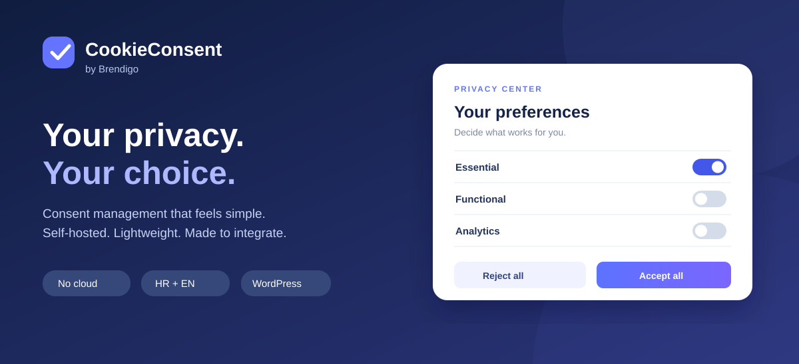
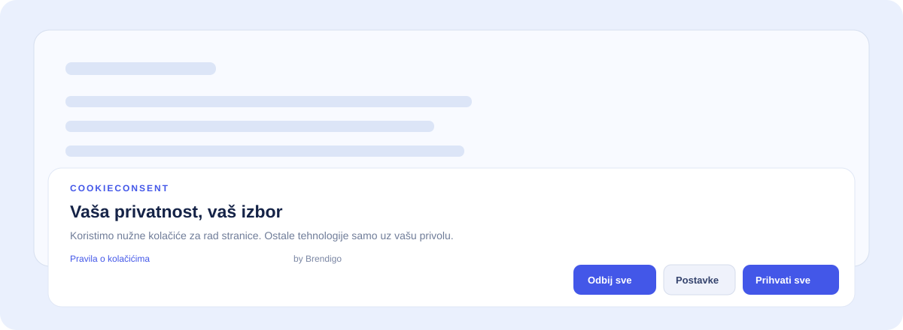

  

# CookieConsent by Brendigo

**Vaša privatnost. Vaš izbor.**  
Samostalni sustav za informiranje posjetitelja i upravljanje privolama na HTML/PHP stranicama te u WordPressu, Joomli, Drupalu, Shopifyju, Magentu, OpenCartu i PrestaShopu.

**[Službena web-stranica](https://cookie.brendigo.com)** · **[Najnovija izdanja](https://github.com/bren-wp/CookieConsent/releases)** · **[Interaktivni konfigurator](demo/configurator.html)** · **[Dokumentacija](docs/README.md)** · **[Razvojni plan](docs/ROADMAP.md)** · **[Brendigo](https://brendigo.com)**

> **Status: v0.11.4 — testno izdanje.** Sustav omogućuje implementaciju upravljanja privolama, ali ne jamči usklađenost pojedine web-stranice i nema status certificiranog CMP-a. Nije automatski blokator svih vanjskih servisa.

## Što dobivate

| Područje | Funkcionalnosti |
|---|---|
| Privola | Nužno, funkcionalno, analitika, marketing; odluke Prihvati sve / Odbij sve / Postavke |
| Granularnost | Pojedinačne usluge s vlastitim identifikatorima; kategorije, svrha, rok i poveznica pružatelja |
| Dizajn | 9 položaja bannera, 3 izgleda, svijetla/tamna/vlastita tema, boje, raspored gumba i položaj modala |
| Lokalizacija | HR, EN, DE, IT, ES, FR i AR uz RTL; tekstovi prilagodljivi po jeziku |
| Pristupačnost | Tipkovnica, kontrola fokusa, semantičke oznake, smanjene animacije, automatizirane A/AA provjere |
| Integracije | Ručno označene skripte/iframeovi, lifecycle API, registracija pružatelja, GPC |
| Povlačenje | Ponovno otvaranje postavki, callbackovi na opoziv, opcionalna pravila brisanja dostupnih first-party kolačića |
| Transparentnost | Lokalna potvrda korisnikova odabira, pregled vidljivih kolačića i browser pohrane |
| Više kartica | Sinkronizacija odabira na istoj domeni bez slanja sadržaja privole |
| WordPress | Administratorske postavke, vizualni pregled, katalog, editor tekstova, JSON backup, ručno blokiranje WP handleova |
| WooCommerce | Zaštita ključnih registriranih skripti košarice i naplate od slučajnog blokiranja |
| Isporuka | 11 ZIP paketa: standalone, WordPress, WP.org kandidat, web, CDN i Joomla, Drupal, Shopify, Magento, OpenCart, PrestaShop |

*Ilustracija je grafički prikaz proizvoda, a ne dokaz da je određena instalacija testirana. Za interakciju otvorite [lokalni demo](demo/index.html), [konfigurator](demo/configurator.html) ili [demo pojedinačnih usluga](demo/services.html).*

## Brza instalacija — HTML ili PHP

Prenesite datoteke iz `packages/core/` na vlastiti hosting i dodajte:

~~~html
<link rel="stylesheet" href="/assets/brendigo-cookieconsent.css">

~~~

Neobvezne vanjske skripte označite prije učitavanja:

~~~html

<button type="button" data-bcc-open>Postavke kolačića</button>
~~~

Skripte koje web-stranica sama izvrši, neoznačene iframeove, piksele i server-side događaje sustav **ne može univerzalno zaustaviti**. Detalji: [Instalacija](docs/INSTALL.hr.md) i [Integracije](docs/INTEGRATIONS.hr.md).

## Službena web-stranica

Dvojezična, responzivna stranica projekta nalazi se u [website/](website/) i distribuira se i kao `cookieconsent-brendigo-website.zip`. Paket sadrži lokalne demonstracije, JS/CSS jezgru i verzionirane CDN datoteke. Predviđena javna adresa je [cookie.brendigo.com](https://cookie.brendigo.com), no domena **nije potvrđena kao postavljena niti se sama aktivira iz GitHuba**. Autor je [Brendigo](https://brendigo.com).

## CMS i webshop integracije

Pored WordPressa, projekt isporučuje šest samostalnih platformskih integracija:

| Platforma | Izvorni kod | Distribucija |
|---|---|---|
| Joomla 5 | [joomla/](joomla/) | `brendigo-cookieconsent-joomla.zip` |
| Drupal 10/11 | [drupal/](drupal/) | `brendigo-cookieconsent-drupal.zip` |
| Shopify | [shopify/](shopify/) | `brendigo-cookieconsent-shopify-extension.zip` — izvorna Theme App Extension, zahtijeva Shopify app i CLI |
| Magento 2.4 | [magento/](magento/) | `brendigo-cookieconsent-magento.zip` |
| OpenCart 4 | [opencart/](opencart/) | `brendigo.ocmod.zip` |
| PrestaShop 8/9 | [prestashop/](prestashop/) | `brendigocookieconsent-prestashop.zip` |

Sve uključuju lokalnu verziju Brendigo JS/CSS jezgre. Platformske administrativne postavke, isporuka i životni ciklus razlikuju se prema arhitekturi CMS-a. **Stvarne instalacije ovih šest platformi još nisu izvršene u CI-u**; statički provjeravamo sintaksu PHP-a, manifeste, sheme, kod i pakiranje. Neobvezne skripte drugih dodataka moraju se zasebno povezati s privolom.

[Zajednički vodič za svih šest platformi](docs/CMS-INTEGRATIONS.hr.md).

## WordPress

1. Preuzmite `brendigo-cookieconsent-wordpress.zip` iz [GitHub Releases](https://github.com/bren-wp/CookieConsent/releases).
2. Otvorite **Dodaci → Dodaj novi → Prenesi dodatak** i aktivirajte dodatak.
3. Otvorite **Postavke → CookieConsent**. Podesite izgled, jezik, politiku kolačića, reviziju privole, usluge i opcionalne integracije.
4. Koristite ugrađeni vizualni pregled, editor tekstova po jeziku i JSON izvoz/uvoz konfiguracije.
5. Provjerite sve stvarne skripte i zahtjeve pri prvoj posjeti, prihvaćanju, odbijanju i povlačenju privole.

**Službeni metapodaci:** Plugin URI [cookie.brendigo.com](https://cookie.brendigo.com), autor **Brendigo**, Author URI [brendigo.com](https://brendigo.com), `Contributors: brendigo`. **Važno:** WordPress.org direktorij ima posebna pravila o obveznom prikazu zasluga i vanjskom učitavanju koda. Trenutačna brendirana ZIP distribucija nije proglašena odobrenom za WordPress.org direktorij.

**Preduvjeti:** WordPress 6.2+ i PHP 7.4+. Izolirani CI testovi nisu zamjena za testiranje konkretnog hostinga. [Potpune WordPress upute](docs/WORDPRESS.hr.md).

## Vlastiti CDN — cookie.brendigo.com

Projekt priprema verzionirani paket za predviđenu adresu:

~~~html

~~~

**Ta adresa nije automatski aktivirana objavom GitHub paketa.** Prije primjene moraju biti postavljeni DNS, HTTPS/TLS i stvarno posluživanje datoteka. Zadana WordPress opcija ostaje lokalno učitavanje. [CDN vodič](docs/CDN.hr.md).

## Kontrola pojedinačnih usluga

~~~javascript
window.BCC_SITE_CONFIG = {
  language: "hr",
  revision: "2026-11",
  services: [{
    id: "site-statistics",
    category: "analytics",
    toggleable: true,
    name: "Statistika web-stranice",
    purpose: "Mjerenje posjećenosti.",
    cookies: "_site_stats",
    duration: "90 dana",
    privacyUrl: "/politika-privatnosti"
  }]
};
~~~

Ovo je opis i kontrola usluge **samo ako je ta usluga uistinu povezana sa sustavom blokiranja**. Katalog sam ne presreće svaki zahtjev.

## JavaScript API

~~~javascript
const cc = window.BrendigoCookieConsent;
cc.getConsent();                  // null ili kategorije
cc.getServiceConsent();           // detaljan odabir usluga
cc.hasConsent("analytics");       // status kategorije
cc.hasServiceConsent("site-statistics");
cc.openPreferences();              // ponovno otvaranje
cc.getConsentReceipt();            // lokalni prikaz korisnikove odluke
cc.downloadConsentReceipt();       // JSON kopija za korisnika
cc.auditLocal();                   // lokalni, ograničeni browser audit
cc.refresh();                      // obrada novo dodanih označenih resursa
cc.reset();                        // poništavanje spremljenog izbora
~~~

[Događaji, povratne funkcije, detaljan API i primjeri](docs/API.hr.md).

## Sigurnost, održavanje i audit

Dokumentirani su [sigurnosni audit](docs/SECURITY-AUDIT.hr.md) i [dead-code audit](docs/DEAD-CODE-AUDIT.hr.md). Uključeni su testovi provjere datuma i roka privole, sigurnih URL-ova, WordPress sanitizacije, redundantnih inicijalizacija, duplih CSS selektora i veličine runtime paketa. Interni pregled nije neovisni penetration test niti pravni certifikat.

**Isporuke: ukupno 11 ZIP paketa**, uključujući šest CMS integracija i dosadašnjih pet paketa. Svi su u GitHub Releases.

**Postojeći paketi:** `cookieconsent-brendigo-standalone.zip`, `brendigo-cookieconsent-wordpress.zip`, `brendigo-cookieconsent-wordpress-org.zip` (kandidat), `brendigo-cookieconsent-cdn.zip` i `cookieconsent-brendigo-website.zip`.

## Lokalni razvoj i provjere

~~~bash
npm run check
npm test
npm run build:cdn
python3 tools/package.py
python3 tools/package.py --verify

# Pregled demonstracije
python3 -m http.server 8000
# Otvoriti http://localhost:8000/demo/configurator.html
~~~

Browser E2E koristi Playwright i axe-core **samo kao razvojne/testne alate**. Testna matrica obuhvaća Chromium, Firefox i WebKit, dok PHP kompatibilnost prolazi izolirane provjere za PHP 7.4 i 8.1–8.4. Detalji: [Razvoj i testiranje](docs/DEVELOPMENT.md), [Kompatibilnost](docs/COMPATIBILITY.md).

## Dokumentacija

| Tema | Dokument |
|---|---|
| Početak i kompletna instalacija | [INSTALL.hr.md](docs/INSTALL.hr.md) |
| Sve konfiguracijske opcije | [CONFIGURATION.hr.md](docs/CONFIGURATION.hr.md) |
| JavaScript API i događaji | [API.hr.md](docs/API.hr.md) |
| WordPress administrator i backup | [WORDPRESS.hr.md](docs/WORDPRESS.hr.md) |
| CDN, verzioniranje i hosting | [CDN.hr.md](docs/CDN.hr.md) |
| Integracije i blokiranje | [INTEGRATIONS.hr.md](docs/INTEGRATIONS.hr.md) |
| Lokalna potvrda privole | [CONSENT-RECEIPT.hr.md](docs/CONSENT-RECEIPT.hr.md) |
| Sigurnost i privatnost | [SECURITY.md](docs/SECURITY.md) |
| Pristupačnost | [ACCESSIBILITY.hr.md](docs/ACCESSIBILITY.hr.md) |
| Zakonski kontrolni popis | [COMPLIANCE.hr.md](docs/COMPLIANCE.hr.md) |
| Produkcijski prihvatni test | [GO-LIVE.hr.md](docs/GO-LIVE.hr.md) |
| Otklanjanje problema | [TROUBLESHOOTING.hr.md](docs/TROUBLESHOOTING.hr.md) |
| Plan razvoja i promjene | [ROADMAP.md](docs/ROADMAP.md) · [CHANGELOG.md](docs/CHANGELOG.md) |

Cjelokupan sadržaj: [docs/README.md](docs/README.md).

## Produkcijska odgovornost

Za svaku web-stranicu treba utvrditi sve pružatelje, pravne osnove, svrhe, kolačiće, vrijeme čuvanja, međunarodne prijenose, načine povlačenja i eventualne obveze evidencije privole. Projekt ne provodi potpun skener, ne briše cookies drugih domena i ne garantira zakonsku sukladnost samom instalacijom. Google Consent Mode v2 Basic adapter je opcionalan i zahtijeva pravilno blokiranje oznaka.

U službenoj distribuciji stalno se prikazuje **by Brendigo** i ne postoji postavka za njegovo isključivanje. MIT licencija ipak dopušta izmjenu izvornog koda i CSS-a; apsolutnu tehničku neuklonjivost nije moguće jamčiti.

---

**CookieConsent by Brendigo** · © 2026 **[Brendigo](https://brendigo.com)** · [MIT licencija](LICENSE) · [GitHub projekt](https://github.com/bren-wp/CookieConsent)

## Provjera stvarne javne isporuke

Za postavljeni web i CDN: `npm run verify:deployment -- https://cookie.brendigo.com`. Validator provjerava HTML stranice, točne verzionirane JS/CSS/loader datoteke, MIME i SHA-256 s CDN manifestom. **Ne postavlja DNS niti hosting.** Upute: [DEPLOY.hr.md](docs/DEPLOY.hr.md) · [Matrica testova](docs/QUALITY-GATES.hr.md).
